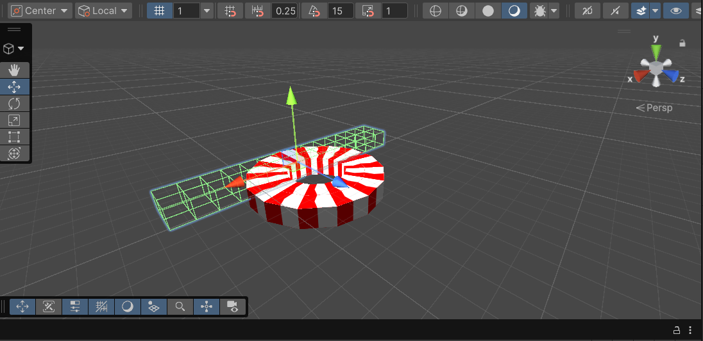
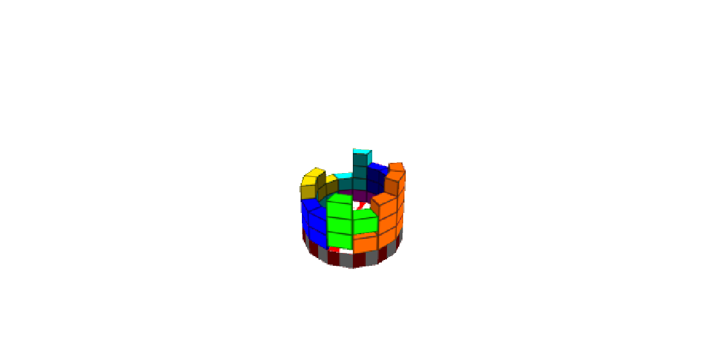

# TETRO

A 3d cylindrical Tetris inspired game.

## Overview

The game uses a displacement shader for programmatically generating curved tetromino blocks around the origin.
It uses an advanced line clear mechanics that takes into account shape speicific chunks and uses coroutines to simulate a physics based, line by line system.
It also uses a depth buffer to generate shadows for the placement of blocks.

* Engine: Unity

## Technical Highlights

* HLSL displacement shader
* Advanced line clear system

### Displacement Shader

The shader uses trignometry to displace vertices in order to curve them around the origin.
Notice the mesh is a straight line and the rendered image is cylindrical.

### Line Clear System

Step by step process:

* Blocks are added to a grid tracking system as soon as they collide with a surface
* The lines are checked to see if any of them are completed
* Line is cleared by removing the children objects
* The remaining pieces are segmented according to the shape they belonged to
* The pieces are turned on again using coroutines to fall down again
* As the enabled pieces collide with another surface, the line clear iterates effectively creating a domino effect

## Controls

| Action | Key   |
| ------ | ----- |
| Move   | ← → ↓ |
| Rotate | Space |

### Challenges

* Rotating curved blocks cannot be generated through static mesh
* Grid system loops back unlike tradtional tetris
* Line clear needs to be implemented in steps to mimic physics

### Solutions

* Programticaly curve blocks using displacement shader
* Use modulus operation to caculate the grid positions from the world positions
* Implement coroutines to make every line and shape clumps act individually

## Future Improvements

* Design UI
* Implement more shader effects
* Make visual improvements

## Credits

Sarmad Tariq

### Tools

* Unity
* Visual Studio

## License

This project is provided for portfolio and educational viewing purposes only.

All code, assets, and content in this repository are the property of the author unless otherwise noted.

No permission is granted to copy, modify, distribute, or use this project or its assets without explicit permission from the author.

All Rights Reserved